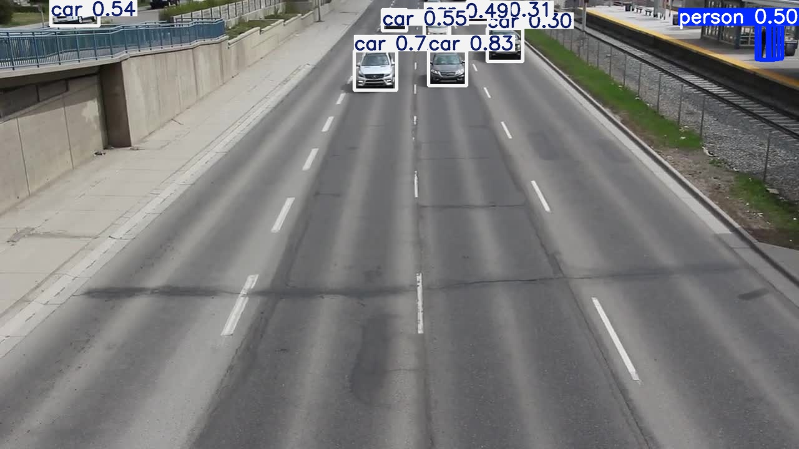
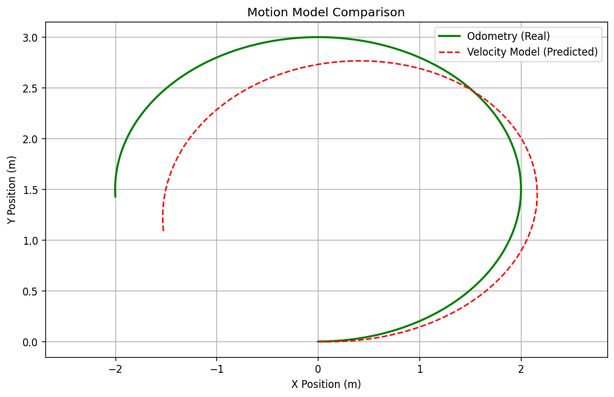

# turtlebot3-yolo-rescuebot

A ROS 2 + Gazebo TurtleBot3 project for **search-and-rescue (SAR) style
simulation** with YOLOv8 object detection, Nav2-based patrol behaviour, an
AprilTag smart-follower, and a custom indoor rescue world.

The ROS 2 package inside this repository is named **`my_yolo_system`**.

---

## Project Timeline

- **Academic development period:** October 2025 – January 2026
- **Case-study completion / viva:** January 2026
- **Repository restructuring & documentation:** July 2026

The perception, navigation, and follower work was developed and assessed as an
academic case study between October 2025 and January 2026, with the viva
completed in January 2026. The repository was subsequently cleaned, packaged as
a proper ROS 2 (`ament_python`) package, and documented in July 2026.

---

## Features

- 🔍 **YOLOv8 object detection** node that logs geo-tagged photo evidence
- 🗺️ **Nav2 patrol** behaviour that visits checkpoints and spins to scan for QR codes
- 🏷️ **AprilTag smart-follower** that chases, visits, and remembers tags with obstacle avoidance
- 🏠 **Custom Gazebo SAR world** (`sar_room_world.sdf`)
- 📈 **CSV plotting utility** for comparing odometry vs. a velocity motion model
- 📦 Proper **ament_python** package layout (`colcon build` ready)

---

## Repository Structure

```text
turtlebot3-yolo-rescuebot/
├── LICENSE
├── README.md
├── package.xml                 # ROS 2 (ament) manifest
├── setup.py                    # Package + entry points
├── setup.cfg
├── requirements.txt            # Non-ROS Python deps (ultralytics, etc.)
├── resource/
│   └── my_yolo_system          # ament resource-index marker
├── launch/
│   └── detection.launch.py     # Launches the YOLO detection node
├── worlds/
│   └── sar_room_world.sdf       # Custom SAR Gazebo world
├── models/
│   ├── yolov8n.pt              # YOLOv8 nano pretrained weights
│   └── qr_best.pt              # Custom-trained QR/object weights
└── my_yolo_system/
    ├── __init__.py
    ├── yolo_node.py            # YOLO detection ROS 2 node
    ├── patrol.py               # Nav2 patrol behaviour
    ├── smart_follower.py       # AprilTag follower behaviour
    └── plot_csv.py             # Motion-data plotting utility
```

---

## Nodes & Executables

| Executable        | Source                | Description                                                        |
| ----------------- | --------------------- | ----------------------------------------------------------------- |
| `yolo_node`       | `yolo_node.py`        | Subscribes to `/camera/image_raw`, runs YOLOv8, and saves geo-tagged evidence to `~/mission_evidence/`. |
| `patrol`          | `patrol.py`           | Drives the robot through Nav2 checkpoints and spins 360° to scan.  |
| `smart_follower`  | `smart_follower.py`   | Follows AprilTags on `/detections` with LiDAR obstacle avoidance.  |
| `plot_csv`        | `plot_csv.py`         | Plots odometry vs. predicted path from a CSV log.                  |

---

## Requirements

- Ubuntu 22.04
- ROS 2 Humble
- Python 3.10+
- Gazebo + TurtleBot3 packages
- Nav2 (`nav2_simple_commander`) — for `patrol`
- `apriltag_msgs` + an AprilTag detector — for `smart_follower`
- Python libs: `ultralytics`, `opencv-python`, `numpy`, `matplotlib`

Install the non-ROS Python dependencies:

```bash
pip install -r requirements.txt
```

Install ROS dependencies with rosdep (run from your workspace root):

```bash
rosdep install --from-paths src --ignore-src -r -y
```

---

## Installation & Build

Clone into the `src` folder of a ROS 2 workspace and build with colcon:

```bash
mkdir -p ~/tb3_ws/src
cd ~/tb3_ws/src
git clone https://github.com/Sathishkumarbanisankarjabade/turtlebot3-yolo-rescuebot.git

cd ~/tb3_ws
source /opt/ros/humble/setup.bash
colcon build --packages-select my_yolo_system
source install/setup.bash
```

Verify the package is visible:

```bash
ros2 pkg list | grep my_yolo_system
```

> Every new terminal must run `source /opt/ros/humble/setup.bash` and
> `source ~/tb3_ws/install/setup.bash` before using the package.

---

## Usage

### 1. Launch the SAR world (Gazebo + TurtleBot3)

Set your TurtleBot3 model and start Gazebo with the custom world. The world
file is installed into the package share directory:

```bash
export TURTLEBOT3_MODEL=burger
ros2 launch turtlebot3_gazebo turtlebot3_world.launch.py \
  world:=$(ros2 pkg prefix my_yolo_system)/share/my_yolo_system/worlds/sar_room_world.sdf
```

You can also open the world directly in Gazebo for inspection:

```bash
gazebo $(ros2 pkg prefix my_yolo_system)/share/my_yolo_system/worlds/sar_room_world.sdf
```

### 2. Run the YOLO detection node

```bash
ros2 run my_yolo_system yolo_node
# or via launch file:
ros2 launch my_yolo_system detection.launch.py
```

Detections above the confidence threshold are saved (throttled to one every
5 s) to `~/mission_evidence/` as a photo plus an entry in `mission_report.txt`,
tagged with the robot's `map → base_footprint` position.

### 3. Run the patrol behaviour (requires Nav2 active)

```bash
ros2 run my_yolo_system patrol
```

### 4. Run the AprilTag smart-follower

```bash
ros2 run my_yolo_system smart_follower
```

### 5. Plot motion results

```bash
ros2 run my_yolo_system plot_csv ~/motion_data.csv
# or directly:
python3 my_yolo_system/plot_csv.py ~/motion_data.csv
# headless / CI: save to a file instead of opening a window
python3 my_yolo_system/plot_csv.py ~/motion_data.csv --save motion_plot.png
```

The CSV is expected to have a header row followed by
`index, real_x, real_y, pred_x, pred_y` columns.

---

## Reproducibility status

Honest account of what has been verified vs. what still needs a fuller host
(re-checked 2026-07-12 on ROS 2 Humble + Gazebo Classic 11, CPU-only inference).

**✅ Verified on this machine**

- `colcon build --packages-select my_yolo_system` builds cleanly; all four
  executables (`yolo_node`, `patrol`, `smart_follower`, `plot_csv`) register.
- `yolo_node`, `patrol`, `plot_csv` import successfully.
- **YOLO inference runs** — `yolov8n.pt` ≈17 ms/frame and the custom `qr_best.pt`
  ≈16 ms/frame on CPU (imgsz 640). Static-image detection:

  

  *Static-image benchmark of YOLOv8n (7 cars + 1 person). This is a still-image
  run to validate the inference path — **not** a live Gazebo capture.*

- `plot_csv.py` renders correctly (shown here on **synthetic** motion data):

  

**⚠️ Requires a fuller host / not run here (no fabricated screenshots)**

- **Full Gazebo end-to-end run** (robot spawned in the SAR world, live
  camera/scan, Nav2 driving the patrol) — needs a GUI-capable ROS 2 + Gazebo host.
- **`smart_follower`** needs `apriltag_msgs` **and** an AprilTag detector node
  publishing `/detections`; it will not import without `apriltag_msgs` installed.
- **World model dependency:** `worlds/sar_room_world.sdf` includes
  `model://qr_cube` (the QR targets) but that model is **not yet bundled** in the
  repo, so a fresh clone must provide `qr_cube` on `GAZEBO_MODEL_PATH` for the
  targets to appear. See Notes.

---

## Notes

- Model weights are installed to the package share directory and loaded by
  `yolo_node` via `ament_index_python`, so no absolute paths need editing.
- If ROS 2 cannot detect the package, re-run `colcon build` and re-`source`
  the workspace.
- Behaviour scripts assume the standard TurtleBot3 topics
  (`/cmd_vel`, `/scan`, `/camera/image_raw`) and a running Nav2 stack where
  applicable.
- **Known gap — `qr_cube` model:** the SAR world `<include>`s `model://qr_cube`
  for the QR scan targets, but that model is not currently vendored in this repo.
  Until it is added under a `models/qr_cube/` directory (or supplied on
  `GAZEBO_MODEL_PATH`), Gazebo will log `Unable to find uri[model://qr_cube]` and
  the targets will be missing. `ground_plane`/`sun` resolve as built-ins.
- `patrol.py` is a **Nav2 waypoint patrol** (six hardcoded goals + a 360° spin at
  each); it is not a frontier/exploration planner. `smart_follower.py` is an
  **AprilTag follower** with LiDAR obstacle avoidance and visited-tag memory.

---

## License

Released under the [MIT License](LICENSE).
